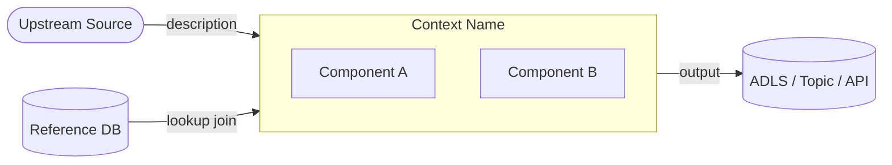
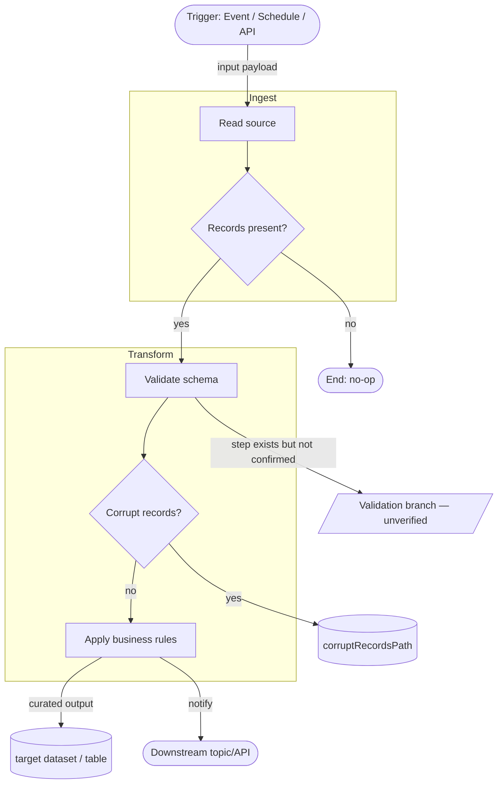

# Universal Bounded Context — Grounding Skill

Produce a **bounded context document**: a living, evidence-tagged replica of how ONE area of
**any codebase** behaves **today** — BRD-agnostic, consistent in shape regardless of stack,
author, or project. Only the "where to look" changes by stack; the required sections are identical.

---

## When to Use

- Asked to create / write / ground / document a **bounded context** for any system or service.
- Capturing **as-is behavior** of a flow, feed, channel, API, module, or service (not a design doc).
- Documenting areas in **any stack**: Java, Python, TypeScript/Node, .NET, Synapse, Spark, SQL, etc.
- Producing a context document with consistent depth and shape that can be compared across services.

**Do NOT use for:** BRD/PRD design, feature authoring, user-story writing, or comparing code to
requirements — those belong in a feature/design layer, not here.

---

## Definition of Done

The 9-section list below **is** the definition of done. A context is complete only when every
section is present, lean, and evidence-tagged.
Sections **7 (what the code does NOT do)** and **9 (open questions)** are the guardrails against
invented behavior — **never skip them**.

---

## Procedure

### Step 1 — Scope the area

- Take the **Area / Service / Flow name** from the user's request or invocation argument.
- If missing or ambiguous, **ask before proceeding**.
- One coherent area per document. If the scope is too large to document meaningfully,
  **stop and propose a split** — by channel, layer, or responsibility — before writing.

---

### Step 2 — Detect the stack and map the evidence

Identify the dominant technology stack, then read the code using the matching evidence map.
More than one map may apply (e.g. a Java service that calls a SQL stored procedure).

#### [ Java / Kotlin / Scala ]
- **Entry points:** controllers, Kafka/JMS/SQS listeners, scheduled jobs, batch mains.
- **Domain:** entities, value objects, enums, domain services (where business rules live).
- **Persistence:** repositories/DAOs, JPA/Hibernate mappings, Liquibase/Flyway migrations, SQL.
- **Integration:** produced/consumed topics, REST clients, OpenAPI/Swagger contracts.
- **Config:** `application.yml/properties`, feature flags, environment profiles.
- **Tests:** unit/integration tests state intended behavior — corroborate, tag as `test-evidence`.

#### [ Python / PySpark / Notebooks (Synapse, Databricks, Jupyter) ]
- **Notebooks:** PySpark/Python/SQL cells — transforms and business logic; note cell order/deps.
- **Pipelines:** pipeline/activity JSON or YAML, parameters, dependencies, triggers/schedules.
- **SQL:** scripts, stored procedures, views, MERGE/UPSERT logic (invariants often live here).
- **Data:** linked services, datasets, Delta/warehouse tables, partitioning, keys, sinks.
- **Config:** parameter files, env configs, key-vault references, `.env` / config YAML.

#### [ TypeScript / JavaScript / Node.js ]
- **Entry points:** Express/Fastify/NestJS route handlers, queue consumers, cron jobs.
- **Domain:** service classes, business logic modules, DTOs, interfaces/types.
- **Persistence:** ORM models (Prisma, TypeORM, Sequelize), raw SQL, schema migrations.
- **Integration:** HTTP clients, event emitters, message bus producers/consumers.
- **Config:** `config/`, `.env`, feature flags, environment-specific overrides.
- **Tests:** Jest/Mocha specs — corroborate, tag as `test-evidence`.

#### [ .NET / C# ]
- **Entry points:** controllers, background services (`IHostedService`), Azure Functions, workers.
- **Domain:** domain models, value objects, aggregate roots, domain events.
- **Persistence:** EF Core / Dapper, migrations, stored procedures.
- **Integration:** `HttpClient` usages, Service Bus consumers/producers, gRPC contracts.
- **Config:** `appsettings.json`, env overrides, feature flags, Azure App Configuration.
- **Tests:** xUnit/NUnit specs — corroborate, tag as `test-evidence`.

#### [ SQL / Database-centric ]
- **Schema:** tables, views, materialized views — keys, constraints, indexes, partitioning.
- **Logic:** stored procedures, triggers, MERGE/UPSERT, computed columns.
- **Data flow:** ETL jobs that populate/consume tables, orchestration tool (SSIS, ADF, Synapse).
- **Config:** connection strings, environment schemas (dev/staging/prod), parameter tables.

> For large or unfamiliar areas, use a **read-only exploration subagent** to map the code
> before writing. Do not guess at structure — read first.

---

### Step 3 — Write the document (exact section order, every section required)

Produce all 9 sections. Keep each lean — **bullets, not walls of prose**:

**1. Identity & Boundary**
- Name of the context; which application/repo/area it covers; one-line purpose.
- What is **in scope** and what is **explicitly out of scope**.
- Upstream sources consumed and downstream consumers fed — **always render as a Mermaid `flowchart LR` context map** (see Diagram Rules).

**2. Ubiquitous Language**
- Domain terms **as used in this code**: field names, statuses, enums, codes — with their real meaning.
- Flag any term that means different things in different places (ambiguity is important to capture).

**3. Inputs & Outputs**
- Feeds, topics/queues, tables, files, APIs — both consumed and produced.
- What **triggers** a run: event, schedule, batch, API call, message.

**4. Data Model / Datasets**
- Key entities and **where state lives**: tables / collections / Delta tables / blobs.
- Important columns/fields, keys, partitioning, persisted vs derived.
- Name the **source-of-truth store**.

**5. Invariants & Rules the Code Guarantees**
- The "always true" behaviors: calculations, eligibility checks, caps, dedup, ordering, etc.
- Every item must carry an **evidence tag** (see Step 4).

**6. Key Flows**
- Main processing steps in order: ingest → validate → transform → decide → write → notify.
- **Always render each distinct flow as a Mermaid `flowchart TD`** (see Diagram Rules).
- One diagram per distinct execution path (e.g. one for the shared pattern, one per feed variant if they diverge). Keep node labels concise — this is a map, not a tutorial.
- Include decision nodes (`{}`) for branches (e.g. empty-batch check, feature flag gate, corrupt-record split).
- Mark storage sinks with cylinder nodes (`[(...)]`) and external systems with stadium nodes (`([""])`)

**7. What the Code Does NOT Do** *(never skip)*
- Limitations, missing checks, unhandled edge cases, "latest wins" behaviors.
- Anything that looks like a gap or an assumption the code makes silently.

**8. Prod vs Non-Prod**
- For each behavior/branch, mark: `in production` | `in-flight / non-prod` | `feature-flagged` | `unverified`.
- If you cannot determine from the code which applies, mark it `unverified` — do not guess.

**9. Open Questions** *(never skip)*
- Anything you **cannot confirm from the code**.
- **Never guess** — list unconfirmed items here instead of inventing answers.

---

### Step 4 — Mermaid diagram rules

Two diagrams are **required** in every bounded context document. Additional diagrams are encouraged where they clarify complex flows.

#### Section 1 — Context map (`flowchart LR`)

Shows the context boundary and its external connections. Required nodes:
- **Upstream sources** — message topics, APIs, files, databases consumed (stadium shape `([""])`)
- **The context itself** — rendered as a `subgraph` containing its components
- **Downstream consumers** — targets the context writes or publishes to
- **Reference data stores** — external lookups (PostgreSQL, MongoDB, etc.) with labeled edges



#### Section 6 — Flow diagrams (`flowchart TD`)

One diagram per distinct execution path. Required elements:
- **Start/end** — stadium shape `(["..."])`
- **Processing steps** — rectangle `["..."]`
- **Decisions / branches** — diamond `{"..."}`
- **Storage sinks** — cylinder `[("...")]`
- **Subgraphs** — group related steps inside `subgraph` blocks (e.g. one subgraph per notebook or service)
- **Edge labels** — always label edges that carry data (e.g. `-->|"deflated JSON"|`)
- Nodes that represent **gaps or unverified steps** use parallelogram shape `/["..."/]`



#### Diagram hygiene rules

- **Never invent topology** — only draw connections confirmed by code evidence.
- **Node labels must match code names** — use actual notebook names, function names, pipeline activity names.
- **Keep labels concise** — use `\n` for multi-line labels inside nodes; avoid sentences.
- **Unverified paths** — use a parallelogram node (`/["step — unverified"/]`) instead of a normal rectangle.
- **Mermaid fenced block** — always wrap in ` ```mermaid ` / ` ``` `, never use image links.

---

### Step 5 — Evidence tagging rules

Every invariant, rule, and data claim must cite its source:

| Stack | Tag format |
|---|---|
| Java/Kotlin/Scala | `[svc: ServiceName/ClassName#methodName()]` |
| Python / Notebook | `[nb: notebook_name / cell N]` or `[py: path/file.py#line]` |
| TypeScript/JS | `[ts: path/file.ts#functionName()]` |
| .NET/C# | `[cs: path/File.cs#MethodName()]` |
| SQL / Stored Proc | `[sql: schema.ProcedureName or path/script.sql]` |
| Pipeline / Config | `[cfg: path/config_file.json — paramName]` |
| Test (corroborating) | `[test: path/TestClass#testName()]` |

---

### Step 6 — Save the document

Save to a location that makes sense for the repo. Suggested convention:

```
docs/bounded-contexts/bounded_context_<area_snake_case>.md
```

If the repo already has a convention (e.g. `Bounded_context/`, `architecture/`, `docs/`), follow it.

---

## Required Mermaid placement in final output

- **Section 1 must contain exactly one context-map Mermaid block** using `flowchart LR`.
- **Section 6 must contain at least one key-flow Mermaid block** using `flowchart TD`.
- Add additional Mermaid flowcharts whenever a distinct branch/path cannot be understood from text alone.
- If a section says a diagram is required, the section is incomplete without a Mermaid fenced block.

---

## Writing Rules

- **Ground, don't invent.** If the code doesn't show it, it goes in Open questions, not Invariants.
- **Lean, not exhaustive.** Capture what's needed to understand behavior; skip boilerplate getters/setters.
- **BRD-agnostic.** Current code only — requirement comparison happens later.
- **Consistent terminology and section order** so contexts are comparable across services and authors.
- **One coherent area per doc.** Oversized areas must be split before writing, never after.

---

## Quality Checklist (reviewer pass)

**Content**
- [ ] Section order and all 9 sections present, in order.
- [ ] Every invariant / rule / data point carries an evidence tag.
- [ ] Section 7 (does NOT do) is populated — not left empty or with "N/A".
- [ ] Section 9 (open questions) is populated — not left empty or with "N/A".
- [ ] Nothing invented — unconfirmed items live in Open questions only.
- [ ] Prod vs non-prod marked (or `unverified`) for each behavior.
- [ ] Area is one coherent flow; oversized areas were split before writing.
- [ ] Terminology matches what the code actually uses (not renamed for clarity).

**Diagrams**
- [ ] Section 1 contains a Mermaid `flowchart LR` context map with upstream sources, the context subgraph, reference stores, and downstream sinks.
- [ ] Section 6 contains at least one Mermaid `flowchart TD` per distinct execution path.
- [ ] Section 6 flowcharts include explicit branch labels (`yes/no`, `match/no-match`, etc.) on decision edges.
- [ ] Every flow diagram includes decision nodes for branches (corrupt-record splits, empty-batch checks, feature-flag gates, etc.).
- [ ] Storage sinks use cylinder nodes; external systems use stadium nodes.
- [ ] Unverified / missing steps use parallelogram nodes, not plain rectangles.
- [ ] No diagram node or edge was invented — all are grounded in code evidence.
- [ ] Edge labels describe what data flows across the edge.
