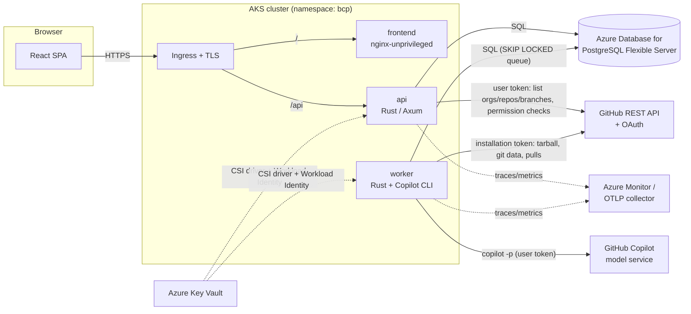
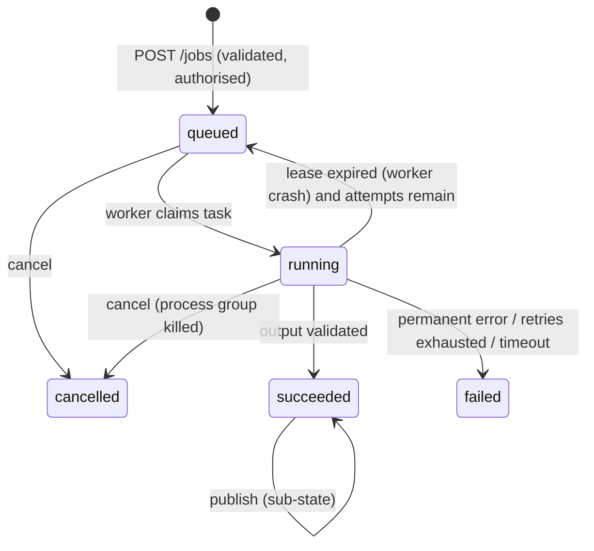

# Architecture

## 1. Components



| Component | Responsibility | Scales on |
|---|---|---|
| `frontend` | Static SPA served by unprivileged nginx. No secrets. | HPA (CPU) |
| `api` | OAuth login, sessions, GitHub browsing on behalf of the user, generator registry and validation, per-user model listing, request validation, authorization, job/batch creation and cancellation, publish requests, SSE progress, audit events. Never runs the agent. | HPA (CPU) |
| `worker` | Claims tasks from the Postgres queue, fetches repository snapshots, runs the **agent adapter**, validates output, computes diffs, publishes branch/commit/PR. | KEDA (queue depth) — `Deployment` (loop mode) or `ScaledJob` (one pod per task) |
| PostgreSQL | Durable state: users, encrypted tokens, sessions, jobs, artifacts, logs, task queue, audit. | — |

The Rust code is a Cargo workspace under `backend/`:

| Crate | Purpose |
|---|---|
| `bcp-core` | Domain types, validation of owner/repo/branch/path/model, error codes, config, AES-GCM token crypto, log redaction, model catalog, generator registry (curated list + allowlist). |
| `bcp-github` | Thin GitHub REST client: App JWT, installation tokens, OAuth code exchange + refresh, repos/branches, tarball, Git Data API, pulls. Retries with backoff; typed errors. |
| `bcp-agent` | Agent bundle manifest, `AgentAdapter` trait, `CopilotCliAdapter`, workspace snapshot/diff, safe tarball extraction, output validation. Ships `bcp-agent-run` for running the adapter without the web app. |
| `bcp-store` | SQLx repositories + embedded migrations. |
| `bcp-api` | Axum HTTP service (binary). |
| `bcp-worker` | Queue consumer and the generate/publish pipelines (binary + library for tests). |
| `mock-github` | Stateful fake GitHub used by integration tests, the e2e suite and credential-free local development. Not deployed. |
| `fake-copilot` | Test double for the Copilot CLI used by local development (`.fake-copilot-mode` selects behaviour). Not deployed. |
| `integration-tests` | End-to-end tests: API + worker + PostgreSQL + mock GitHub + scripted agent runtime. |
| `bcp-services` | Token service shared by API and worker (decrypt, refresh under a row lock) and the `GeneratorResolver` (fetch a generator repository at a pinned commit, load and clamp its bundle). |

## 2. Agent adapter contract

```rust
#[async_trait]
pub trait AgentAdapter: Send + Sync {
    /// Static description: agent id, version (bundle hash), pinned model if any, declared inputs.
    fn describe(&self) -> AgentDescriptor;
    /// Run the agent against a prepared workspace. Must not touch anything outside `req.workspace`
    /// and `req.scratch_dir`. Streams progress through `sink`. Honours `cancel`.
    async fn run(&self, req: AgentRunRequest, sink: &dyn ProgressSink, cancel: CancellationToken)
        -> Result<AgentRunOutcome, AgentError>;
}
```

- `AgentRunRequest`: workspace dir, scratch dir, model id, validated input values, repository identity
  (owner/repo/branch/sha — used only for prompt rendering), Copilot token (secret, passed via env only), timeout.
- `AgentRunOutcome`: exit status, duration, transcript path, CLI version.
- Output detection is **not** the adapter's job: the worker snapshots the workspace before and after the run
  and classifies every change against the bundle's `output.paths` allowlist. Changes outside it are reported as
  *unexpected* and never committed.

`CopilotCliAdapter` builds an argv vector (no shell):

```
copilot -p <rendered prompt> --agent <bundle agent id> --model <model> -s --no-ask-user
        --allow-tool <bundle allow list> --deny-tool <bundle deny list>
        --disable-mcp-server <name>...   --log-dir <scratch>/logs   --share <scratch>/transcript.md
        [--no-custom-instructions]  [--output-format json]
```

with a scrubbed environment: `COPILOT_HOME=<scratch>/copilot-home` (contains a verbatim copy of the bundle's
agent files under `agents/`), `COPILOT_GITHUB_TOKEN=<user token>`, `COPILOT_AUTO_UPDATE=false`, `HOME`,
`PATH`, `LANG`. The child runs in its own process group so cancellation/timeouts kill the whole tree.

### Generators and batches

The portal is a generic generation platform: *what* produces the documentation is a **generator** — an agent
bundle (`bundle.yaml` + agent files) — and a request can cover **several repositories** at once.

| Source | Where the bundle comes from | Who can use it |
|---|---|---|
| `builtin` | Baked into the worker image (`agent-bundle/`), unrestricted as before | everyone |
| `curated` | A repository listed in `config/generators.yaml` | everyone |
| `user` | A repository the user added (`POST /api/generators`), saved per user | the user; the repository must match the operator `allow` patterns |

Repository generators are resolved to the head commit of their branch when the job is **created** (the API
fetches and loads the bundle, so inputs, model lock and output paths shown in the form are the real ones) and the
job stores that commit (`jobs.generator_sha`). The worker downloads exactly that revision with the requesting
user's token, loads it under the platform's hard limits (no shell/url/memory tools, no MCP servers, no repository
instructions, documentation-only outputs below `docs/`; see `docs/security.md`) and runs it with a per-bundle
adapter. The job also records the bundle's output allowlist, which publishing re-checks. A bundle's own
`bundle.yaml` can sit next to existing agent files with `agents_dir: "."`.

`POST /api/bounded-context/batches` validates the generator, model and inputs once and then creates one ordinary
job per repository (checked a few at a time); jobs share `batch_id` and are otherwise independent — each is
reviewed, retried, cancelled and published on its own. Duplicate prevention is per
user/repository/branch/model/**generator**.

### Models

`GET /api/models` asks the Copilot API for the models the signed-in user's token can use (cached ~2 minutes) and
falls back to the operator catalog (`config/models.yaml`) with an explicit `warning` when that fails; job creation
validates against the same list. GitHub does not document this listing endpoint, so it is best-effort by design
(see `docs/discovery.md`); `BCP_COPILOT_API_URL=off` disables it.

## 3. Identity and GitHub permission model

One **GitHub App** is used for both sign-in and repository operations.

| Operation | Credential | Why |
|---|---|---|
| Sign-in, list installations/repos/branches, permission checks | **User-to-server token** (`ghu_`) from the App's OAuth flow | Results are the intersection of what the user can access and where the App is installed — users only see repositories they are authorised for, and org App-installation policies apply. |
| Download repository snapshot | **Installation token** minted per task, scoped to the single repository, `contents: read` | Least privilege, short lived (1h), never shared with the agent. |
| Branch, commit, PR | **Installation token** scoped to the single repository, `contents: write`, `pull_requests: write` | Server-side, auditable, minimal. Only minted after verifying the *user* has `push` permission. |
| Copilot model calls by the agent | The requesting user's **user-to-server token** via `COPILOT_GITHUB_TOKEN` | Consumes *that user's* Copilot entitlement and policies. No shared service seat. |

GitHub App permissions (repository): `Metadata: read`, `Contents: read & write`, `Pull requests: read & write`.
Account permissions: whatever Copilot requires for `ghu_` tokens (see discovery R3). No org/admin permissions.

Tokens are encrypted with AES-256-GCM (key from Key Vault) before they are stored, refreshed server-side, and
never sent to the browser. The browser holds only an opaque, HttpOnly, `SameSite=Lax` session cookie; the
server stores a SHA-256 of the session id.

## 4. Job lifecycle



Generation stages (shown in the UI, no fake percentages):
`queued → preparing → fetching_repository → running_agent → validating_output → completed`.

Publishing is a sub-state of a *succeeded* job:
`not_started → queued → running(checking_base → creating_commit → creating_branch → creating_pull_request) → succeeded | failed`.

### Queue

`job_tasks` in Postgres, claimed with `FOR UPDATE SKIP LOCKED`, leased with a heartbeat (`lease_until`). A
reaper returns expired leases to `pending` (or fails them when `attempts >= max_attempts`). Transient errors
(GitHub 5xx, secondary rate limits, network) are retried with exponential backoff + jitter by re-scheduling the
task (`run_after`); permanent errors fail immediately. `NOTIFY bcp_tasks` wakes idle workers; they also poll.

### Idempotent publishing

Every step persists its result before the next starts, so a retry resumes rather than repeats:

1. **Check base**: if the base branch head moved since generation and the output file changed in between,
   fail with `base_branch_changed` (user must regenerate). Otherwise the commit is parented on the analysed SHA.
2. **Commit**: tree = base tree + generated files only; message carries a `Bounded-Context-Job: <id>` trailer.
3. **Branch**: `bounded-context/<repo-slug>-<short-job-id>`. If it exists and points at our commit → reuse; if it
   exists with foreign history → `branch_conflict` (never force-push).
4. **PR**: reuse an open PR for the same head/base, else create one. Never merged automatically.

### Duplicate prevention

A partial unique index rejects a second *active* job for the same user/repo/branch/model (`409 duplicate_job`
with the existing id). Publish tasks have a partial unique index per job.

## 5. Data model

See `backend/crates/bcp-store/migrations/0001_init.sql` for the authoritative schema.

| Table | Contents | Notes |
|---|---|---|
| `users` | GitHub id, login, name, avatar | |
| `github_tokens` | encrypted access/refresh tokens + expiries | AES-256-GCM, key not in DB |
| `sessions` | sha256(session id), user, expiry | |
| `jobs` | inputs, status/stage, base SHA, agent version, generator (source, repo, branch, path, pinned SHA), batch id, output allowlist, error, publish fields | No tokens, no repository source |
| `user_generators` | generator repositories a user saved | per user; re-validated against the allowlist on use |
| `job_artifacts` | generated file content, base content of the same file, unified diff | Only the agent's output path(s) |
| `job_events` | redacted log lines and stage transitions | capped per job |
| `job_tasks` | queue | |
| `audit_events` | generation requested, cancelled, branch created, commit created, PR created | append-only |

## 6. Security controls (summary — details in `docs/security.md`)

- Strict validators for owner, repo, branch, paths, model ids, input values; no user value ever reaches a shell.
- Agent sandbox: separate pod, non-root, read-only root FS, all capabilities dropped, seccomp `RuntimeDefault`,
  per-job scratch dir, CPU/memory/time limits, egress restricted by NetworkPolicy, no shell/URL/MCP tools.
- Safe tarball extraction: no absolute paths, no `..`, no symlinks/hardlinks/devices, size and file-count caps.
- Output allowlist: only `output.paths` are committed; Markdown preview sanitised in the browser.
- CSRF: `SameSite=Lax` cookie + `Origin` check + custom header on mutating requests.
- SSRF: GitHub base URLs come from config only; no user-provided URLs are fetched.
- Rate limiting per user, 64 KiB request bodies, audit trail, token redaction in logs.
