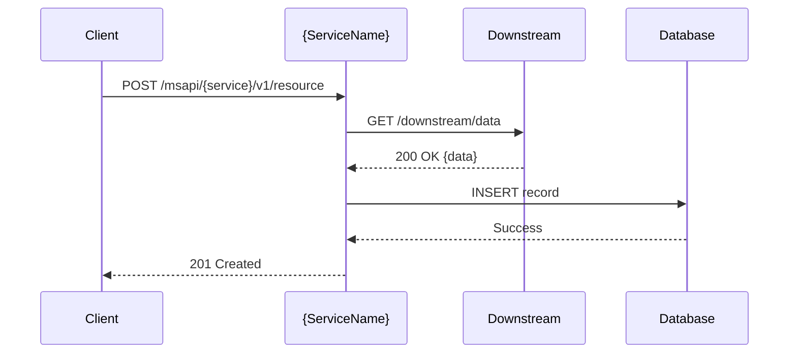

# omni-rule-documentation-requirements

> **Type**: OMNI rule sub-skill (atomic). Invoked by parent `omni-*` skills via the `skill` tool when a workflow mandates this rule. Not user-facing — do not route user prompts here.
>
> **Source rule**: `.devin/rules/documentation-requirements.md` — apply the content below in full and verbatim.

---

# Documentation Requirements

> **Tier**: OMNI Rules | **Version**: 2.0.0 | **Applies To**: All OMNI microservices

---

## 🔥 HARD-STOPS

- ✘ **No ticket closed without README update**: See [`omni-rule-execution-planning` § A8](`omni-rule-execution-planning`) for the authoritative gate checklist
- ✘ **No new endpoint without OpenAPI annotation**: See [`omni-rule-rest-api-design-standards`](`omni-rule-rest-api-design-standards`) for full OpenAPI requirements
- ✘ **No README without YAML front matter**: `title`, `version`, `last_updated`, `author` are required
- ✘ **No architecture diagram missing**: Every service README must include a Mermaid architecture diagram
- ✘ **No execution plan without gap analysis**: HS-14 compliance matrix required (see L0 below)

---

## L0. Execution Plan Gap Analysis (HS-14 — MANDATORY)

> **Always-On Enforcement**: This requirement is automatically enforced for `/create-execution-plan` and `/implement-execution-plan` workflows.

Every execution plan must include a **Rules, Workflows, Skills & Archetypes Compliance Matrix** that documents:

1. ✅ **Rules compliance** — which HS-X hard-stops were applied
2. ✅ **Workflows used** — which `/create-execution-plan`, `/implement-execution-plan` workflows ran
3. ✅ **Skills invoked** — TDD orchestrator, security scanner, test coverage validator, etc.
4. ✅ **Archetypes detected** — which archetype patterns were identified and used
5. ✅ **Gap analysis** — what was skipped, why, and impact assessment

### Required Sections

#### Section 1: Phase-by-Phase Compliance Table

**After Plan Creation:**

| Category | Item | Location | Used? | Purpose |
|----------|------|----------|-------|---------|
| Workflow | `/omni-plan --create` (legacy: `/create-execution-plan`) | `.devin/workflows/omni-plan.md` | ✅/❌ | Execution plan generation |
| Template | OMNI Execution Plan Template | `../omni-plan/templates/OMNI-EXECUTION-PLAN-TEMPLATE.md` | ✅/❌ | Structured plan format |
| Workflow | `/omni-tdd-story` | `.devin/workflows/omni-tdd-story.md` | ✅/❌ | Guided Red/Green/Refactor implementation |
| Workflow | `/omni-security-validate` | `.devin/workflows/omni-security-validate.md` | ✅/❌ | Grouped security validation workflow |
| Rule | HS-5: Documentation Required | `omni-rule-documentation-requirements` | ✅/❌ | README + execution plan |
| Rule | HS-11: TDD Mandate | `omni-rule-testing-foundation` | ✅/❌ | Tests before production code |

**After Implementation:**

| Category | Item | Location | Used? | Purpose |
|----------|------|----------|-------|---------|
| Workflow | `/omni-scaffold --implement` (legacy: `/implement-execution-plan`) | `.devin/workflows/omni-scaffold.md` | ✅/❌ | Phase-by-phase implementation |
| Workflow | `/omni-test-tdd` | `workflows/omni-test-tdd.md` | ✅/❌ | TDD compliance validation |
| Workflow | `/omni-test-coverage` | `workflows/omni-test-coverage.md` | ✅/❌ | Coverage gates (100% min) |
| Workflow | `/omni-security-analyze` | `workflows/omni-security-analyze.md` | ✅/❌ | Deep analysis plus quick security scan |
| Skill | Build Gates Validator | `workflows/omni-quality-build.md` | ✅/❌ | Compile/test gates |
| Rule | HS-3: Test Coverage Minimum | `omni-rule-testing-foundation` | ✅/❌ | 100% coverage required |
| Rule | HS-7: Build Gates | `omni-rule-build-deployment-gates` | ✅/❌ | All gates must pass |
| Test | Unit Tests (`*Spec.groovy`) | `omni-rule-unit-testing-standards` | ✅/❌ | **Mandatory** — every new/modified class |
| Test | Component Tests (`*CTSpec.groovy`) | `omni-rule-component-testing-standards` | ✅/❌ | **Mandatory** — every new/modified REST endpoint |
| Test | Integration Tests (`*IT.groovy`) | `{domain}-team-documents/.devin/rules/{domain}-rules.md` (Testing section) | ✅/❌ | **Mandatory** if execution plan includes integration test phase |
| Test | Performance Tests (Gatling `*Simulation.java`) | `.devin/workflows/omni-validate-deployment.md §5.5` (`/omni-test-performance-implement` / `/omni-test-performance`) | ✅/❌ | **Conditional** — required if execution plan includes performance testing phase |
| Pattern | [Domain-Specific Pattern] | `{domain}-team-documents/patterns/` | ✅/❌ | Domain best practices |

#### Section 2: Gap Analysis

| Item | Why Skipped | Impact | Recommendation |
|------|-------------|--------|----------------|
| [Skipped Skill/Rule] | [Reason — e.g., "Not applicable", "Manual review only"] | Low/Medium/High | [Action — e.g., "Run before PR", "N/A"] |

**Impact Levels:**
- **Low**: No risk to functionality or compliance
- **Medium**: Minor risk, compensating control exists
- **High**: Significant risk, requires waiver or immediate remediation

#### Section 3: Archetype Usage

| Archetype | Detected? | Workflows Used | Patterns Applied |
|-----------|-----------|----------------|------------------|
| [Archetype Name] | ✅/❌ | [List of workflows] | [List of patterns] |

**Common Archetypes:**
- Domain Service (Java/Groovy)
- Enterprise Microservice (Java/Spring Boot or Python/FastAPI)
- Frontend Only (React/TypeScript)
- Backend Only (FastAPI/Poetry)
- Streamlit Developer
- Git Secret Remediation
- Java/Python Library Upgrade
- Security Vulnerability Remediation

### Enforcement Gates

- **Creation Gate**: Gap analysis table must be present before implementation begins
- **Implementation Gate**: Table must be updated with implementation evidence before PR submission
- **Review Requirement**: Code reviewers must verify gap analysis completeness and accuracy

---

## L1. README Structure (MANDATORY)

Every microservice README must follow this template structure:

```markdown
---
title: "{Service Name}"
version: "X.Y.Z"
last_updated: "YYYY-MM-DD"
author: "{Team Name}"
---

# {Service Name}

## Overview

[2-3 sentence description of what the service does and its business value]

## Architecture

[Mermaid architecture diagram — graph TD or sequenceDiagram]

## Project Structure

[Key package/directory layout]

## API Endpoints

[Table of endpoints — Method, Path, Description, Auth]

## Workers / Processes

[Domain-specific: workers, jobs, consumers]

## Configuration

[Key application.properties entries]

## Dependencies

[Upstream/downstream services]

## Build & Test

[mvn commands to build and test]

## Deployment

[Helm / ConfigRole / CI-CD notes]

## Change Log

| Version | Date       | Author | Changes     |
| ------- | ---------- | ------ | ----------- |
| X.Y.Z   | YYYY-MM-DD | Name   | Description |
```

---

## L2. Mermaid Diagrams

### Architecture Diagram (Required)

```
```mermaid
graph TD
    A[Client] -->|REST| B[{ServiceName}]
    B -->|HTTP| C[Downstream Service 1]
    B -->|Kafka| D[Event Topic]
    B -->|SQL| E[Database]
    style B fill:#007bff,color:#fff
```

```

### Process Flow (Required for complex operations)
```



```

---

## L3. Javadoc Standards

### Required Javadoc Locations
- **All public classes**: Class-level Javadoc describing purpose
- **All public methods**: Method-level Javadoc with `@param`, `@return`, `@throws`
- **All REST resource methods**: Javadoc describing the operation, inputs, outputs

### Javadoc Template
```java
/**
 * Retrieves customer profile for the given account number.
 *
 * <p>Queries the customer graph database and returns a full customer profile
 * including account details, contact information, and service subscriptions.
 *
 * @param accountNumber the AT&T account number (10-digit numeric string)
 * @return {@link CustomerResponse} containing full customer profile
 * @throws CustomerNotFoundException if no customer exists for the given account number
 * @throws ServiceException if the downstream database is unavailable
 */
public CustomerResponse getCustomer(String accountNumber) { ... }
```

---

## L4. API Documentation

### OpenAPI Spec Location

Each service publishes its OpenAPI spec at:

- **UI**: `/{servicename}/swagger/index.html`
- **JSON**: `/{servicename}/api-docs`
- **YAML file**: `src/main/resources/{servicename}.yaml`

### SpringDoc Configuration

```java
@OpenAPIDefinition(
    info = @Info(
        title = "{Service Name} API",
        version = "v1",
        description = "REST API for {service description}",
        contact = @Contact(name = "{Team Name}", email = "{team-email}@att.com")
    )
)
@Configuration
public class OpenApiConfig { }
```

---

## L5. Change Log Requirements

Every change log entry must include:

```markdown
## Change Log

| Version | Date       | Ticket       | Author   | Changes                                 |
| ------- | ---------- | ------------ | -------- | --------------------------------------- |
| 1.2.0   | 2026-03-11 | SPTXXX-12345 | dev-name | Added GET /customers endpoint           |
| 1.1.0   | 2026-02-15 | SPTXXX-11000 | dev-name | Added Kafka consumer for billing events |
| 1.0.0   | 2026-01-01 | SPTXXX-10000 | dev-name | Initial service creation                |
```

### Update Rules

1. **Always update** README change log when code changes are made
2. **Include ticket ID** in every entry
3. **Increment version** following semantic versioning (major.minor.patch)
4. **Never modify** existing entries — only add new ones

---

## L6. Runbook Requirements

For production-grade services, a runbook must be maintained at `docs/runbook.md`:

```markdown
# {Service Name} Runbook

## Alerting

### Alert: High Error Rate

**Trigger**: Error rate > 5% for 5 minutes
**Symptoms**: ...
**Investigation**:

1. Check logs: `kubectl logs -l app={service} --tail=100`
2. Check downstream: ...
   **Resolution**: ...

## Common Issues

### Issue: Slow Response Times

**Symptoms**: ...
**Root Cause**: ...
**Resolution**: ...

## Deployment Notes

...
```

---

## L7. Governance

### Rule Update Process

1. Propose the change (issue with rationale)
2. Get explicit approval from team lead
3. Update rule file with version bump and change log entry
4. Cross-check for conflicts with existing rules
5. Notify affected teams

### Knowledge Document Modification Rules

- **Do NOT modify** templates without explicit user direction
- **Update documentation** when code changes require it — README updates are mandatory per [`omni-rule-execution-planning` § A8](`omni-rule-execution-planning`)
- **Keep team docs** as source of truth; do not duplicate in service repos
